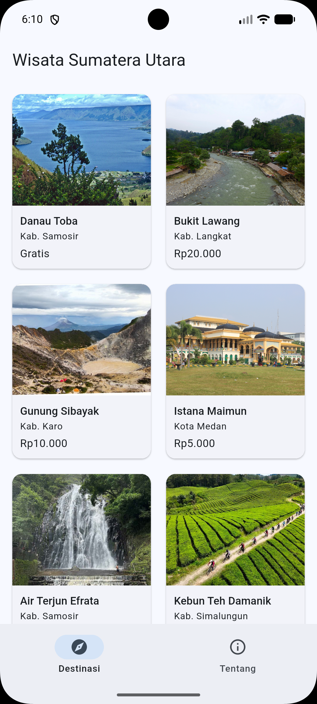
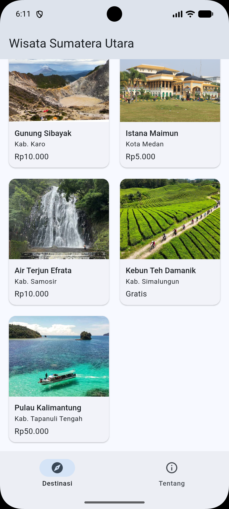
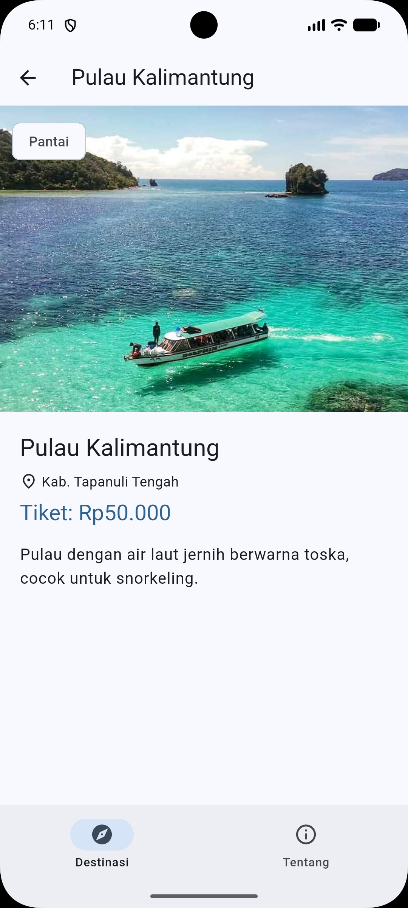
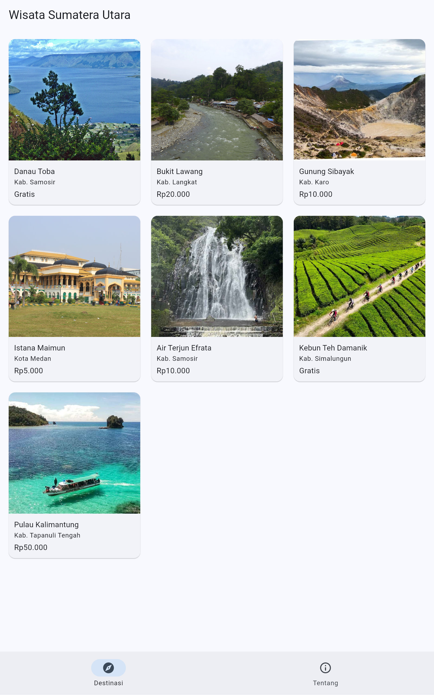
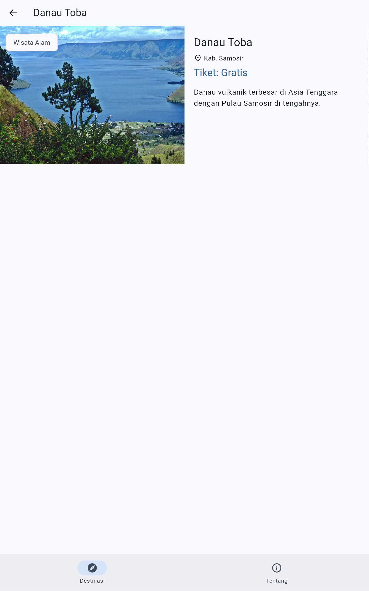

# Wisata Sumatera Utara

Aplikasi panduan wisata Sumatera Utara berbasis Flutter dengan layout responsif dan navigasi multi-screen. Dibuat untuk Tugas Rutin 6 mata kuliah Pemrograman Mobile (Indikator 6.1: layout responsif).

## Identitas

- Nama: Juhraini Helfiana Lexa
- NIM: 4243550018
- Kelas: PSIK 24C
- Program Studi: Ilmu Komputer, FMIPA, Universitas Negeri Medan
- Mata kuliah: Pemrograman Mobile (3KOM40215), Pertemuan 6
- Judul tugas: Aplikasi Wisata Sumatera Utara (Responsif & Multi-Screen)

## Fitur

- 7 destinasi wisata, masing-masing memiliki nama, kabupaten/kota, kategori, deskripsi, harga tiket atau "Gratis", dan foto.
- Halaman daftar berupa grid adaptif dengan 2, 3, atau 4 kolom sesuai lebar ruang.
- Halaman detail lewat go_router dengan path parameter (`/destinasi/:id`). ID yang tidak dikenal menampilkan halaman "Destinasi tidak ditemukan".
- Halaman detail memiliki dua susunan: vertikal pada layar sempit dan berdampingan pada layar lebar. Label kategori ditumpuk di atas foto dengan `Stack`.
- Kerangka navigasi dua tab (Destinasi dan Tentang): `NavigationBar` pada lebar di bawah 840 dp dan `NavigationRail` pada 840 dp ke atas.
- Halaman Tentang dengan header `Stack`.

## Struktur Proyek

```
lib/
├── main.dart              # aplikasi, router go_router, kerangka navigasi
├── data.dart              # model Destinasi, data contoh, extension rupiah
├── halaman_daftar.dart    # grid responsif dan KartuDestinasi
├── halaman_detail.dart    # detail destinasi (responsif) dan halaman tidak ditemukan
└── halaman_tentang.dart   # header Stack dan info pembuat
assets/images/             # foto destinasi
screenshots/               # tangkapan layar untuk README
test/widget_test.dart      # widget test navigasi daftar ke detail
```

## Tangkapan Layar

### Ponsel (emulator Android, Android Studio)

| Daftar (atas) | Daftar (digulir ke bawah) | Detail |
|---------------|---------------------------|--------|
|  |  |  |

Di ponsel, grid memakai 2 kolom, `NavigationBar` berada di bawah, dan halaman detail tersusun vertikal. Dua gambar daftar menunjukkan bagian atas dan bagian bawah grid, sehingga ketujuh destinasi terlihat.

### Tablet (Chrome DevTools device mode, iPad Air 820 x 1180 dp)

| Daftar | Detail |
|--------|--------|
|  |  |

Di tablet, grid memakai 3 kolom, `NavigationBar` tetap di bawah, dan halaman detail menampilkan foto dan info berdampingan.

## Keputusan Responsif

Aplikasi memakai dua alat ukur sesuai cakupan keputusannya. `MediaQuery.sizeOf(context)` dipakai pada `KerangkaNavigasi` karena pilihan navigasi berlaku untuk seluruh aplikasi dan bergantung pada lebar jendela. Batasnya 840 dp mengikuti window size class Material 3: di bawah 840 dp memakai `NavigationBar` di bawah layar, mulai 840 dp memakai `NavigationRail` di samping. `LayoutBuilder` dipakai pada halaman daftar dan detail karena keputusannya bergantung pada ruang yang diberikan parent kepada widget itu. Pada halaman daftar, `constraints.maxWidth` menentukan kolom grid: kurang dari 600 dp memakai 2 kolom, kurang dari 900 dp memakai 3 kolom, selebihnya 4 kolom. Ini penting karena saat `NavigationRail` tampil, ruang grid lebih sempit daripada lebar layar. Pada halaman detail, lebar 700 dp atau lebih menampilkan foto dan info berdampingan dalam `Row`, sedangkan yang lebih sempit menyusunnya vertikal dalam `ListView`. Pada tablet (820 dp), grid memakai 3 kolom, navigasi tetap di bawah, dan detail berdampingan. Teks panjang ditangani dengan `maxLines` dan ellipsis agar tidak overflow pada lebar 360 sampai 1280 dp.

## Cara Menjalankan

```bash
flutter pub get
flutter run
```

Untuk menjalankan di browser: `flutter run -d chrome`. Untuk pengecekan kode dan tes:

```bash
flutter analyze
flutter test
```

## Sumber Foto

Foto destinasi dikumpulkan dari hasil pencarian Google. Sebagian bersumber dari Wikipedia dan Wikimedia Commons, dan sebagian lainnya dari situs web lain. Foto dipakai semata-mata untuk keperluan tugas perkuliahan dan tidak untuk tujuan komersial. Hak cipta setiap foto tetap dimiliki oleh pemilik atau fotografer aslinya.

| Berkas | Destinasi |
|--------|-----------|
| `danau_toba.jpg` | Danau Toba |
| `bukit_lawang.jpg` | Bukit Lawang |
| `gunung_sibayak.jpg` | Gunung Sibayak |
| `istana_maimun.jpg` | Istana Maimun |
| `air_terjun_efrata.jpg` | Air Terjun Efrata |
| `kebun_teh_damanik.jpg` | Kebun Teh Damanik |
| `pulau_kalimantung.jpg` | Pulau Kalimantung |

## Pernyataan Penggunaan AI

Dalam pengerjaan tugas ini, saya menggunakan Claude (Anthropic) sebagai alat bantu untuk memahami instruksi, memeriksa dan memperbaiki kode, serta mengatasi kendala pengujian. Aplikasi tetap saya jalankan dan uji melalui Chrome, emulator Android, flutter analyze, dan flutter test.
